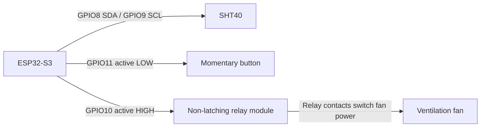

# Shed Ventilation

An ESP32-S3 project derived from the ESP32 Project Foundation. Its goal is to ventilate a closed shed when indoor temperature is high, while reporting sensor readings and fan state to Home Assistant (HA).

## Status

This branch contains the shed controller, NVS setpoint store, SHT40 driver, relay/button services, and MQTT/HA implementation. Host tests and the ESP32-S3 UART firmware build pass. Physical sensor/relay operation, HA discovery, OTA on the shed device, and end-to-end behavior have not yet been verified. Confirm relay polarity and boot behavior before connecting a fan.

The implementation plan is in [docs/SHED_VENTILATION_PLAN.md](docs/SHED_VENTILATION_PLAN.md). This project is maintained on the `shed-ventilation` branch so foundation updates can be merged forward.

## Startup and Fan Indicator

The onboard WS2812 LED on GPIO48 provides the existing slow-blue Wi-Fi and fast-blue MQTT startup indication. After startup, firmware sets it green when the fan relay output is on and off when the output is off. It is not an independently controllable HA entity. Serial diagnostics use 115200 baud.

## Fan and Home Assistant Behavior

The shed device uses the existing MQTT broker and HA MQTT discovery. Entities include a fan switch, indoor temperature and humidity, outdoor temperature, sensor/weather status, control mode, and editable OFF/ON setpoint numbers. HA ON/OFF commands and the local digital button temporarily override automatic control until the next automatic thermostat state transition.

The default setpoints are 80°F OFF and 110°F ON. Whole-degree values from 60°F through 120°F are accepted, provided OFF is at least 2°F below ON. Values persist in ESP32 NVS. The shed publishes a retained JSON state report containing the accepted setpoints and fan/sensor status; HA displays the setpoints reported by the device. Invalid commands leave stored values unchanged.

| Purpose | Topic | Payload |
| --- | --- | --- |
| Fan command | `devices/ShedVentilation_esp32s3/fan/set` | `ON` or `OFF`, not retained |
| OFF setpoint command | `devices/ShedVentilation_esp32s3/setpoint/off/set` | Whole-degree °F number, not retained |
| ON setpoint command | `devices/ShedVentilation_esp32s3/setpoint/on/set` | Whole-degree °F number, not retained |
| Device-reported state | `devices/ShedVentilation_esp32s3/state` | Retained JSON with fan state, readings/freshness, fault flags, and accepted OFF/ON setpoints |
| Availability | `devices/ShedVentilation_esp32s3/availability` | Retained `online` / `offline` with MQTT Last Will |
| Tempest outdoor temperature | `weather/outdoor_temperature_c` | Retained numeric °C published by HA |
| Future Weather notices | `weather/events` | Reserved for non-retained events; not consumed in this version |

HA discovery entities use templates against the retained device state. When an update is rejected or storage fails, the device republishes its last accepted setpoints and reports a setpoint-storage fault.

HA already receives Tempest data. The automation below publishes the outdoor temperature to MQTT. With fresh outdoor data, the effective OFF threshold is the greater of the saved OFF setpoint and outdoor temperature plus 2°F. The effective ON threshold is the greater of the saved ON setpoint and effective OFF threshold plus the configured 2°F restart gap. Stale or missing outdoor data falls back to the saved setpoints. The device does not query the HA API or consume Tempest UDP directly.

The HA automation below publishes the current Tempest outdoor temperature in Celsius as a numeric retained value on `weather/outdoor_temperature_c`. Replace the example entity ID with the outdoor temperature entity from your Tempest integration. The ESP32 subscribes to that topic and marks the value stale after ten minutes. Future weather events such as Rain use a separate non-retained `weather/events` topic so they cannot overwrite the latest temperature state.

```yaml
alias: Publish Tempest temperature to shed ventilation
mode: single
trigger:
  - platform: state
    entity_id: sensor.tempest_outdoor_temperature
  - platform: homeassistant
    event: start
condition:
  - condition: template
    value_template: "{{ is_number(states('sensor.tempest_outdoor_temperature')) }}"
action:
  - service: mqtt.publish
    data:
      topic: weather/outdoor_temperature_c
      payload: >-
        
        
        
          {{ ((temperature - 32) * 5 / 9) | round(2) }}
        
          {{ temperature | round(2) }}
        
      retain: true
```

The broker is currently configured in the foundation as plain MQTT/TCP on the home LAN. Do not send secrets over MQTT or expose an unauthenticated broker/device to untrusted networks.

## GPIO Wiring

These are the current configurable defaults. Verify the selected pins against the exact board revision and confirm the relay input is safe during reset before connecting a fan.

To reconfigure the assignments, edit `I2cSdaPin`, `I2cSclPin`, `FanRelayPin`, `ManualButtonPin`, and `LedPin` in [include/AppConfig.h](include/AppConfig.h). Relay and button polarity are set by `FanRelayActiveHigh` and `ManualButtonActiveHigh`; the SHT40 address (`0x44` or `0x45`) is set by `Sht40Address`. Update the table and diagram below to match any changes.

| Signal | ESP32-S3 GPIO | Direction / default |
| --- | ---: | --- |
| SHT40 SDA | GPIO8 | I²C data, 3.3V logic |
| SHT40 SCL | GPIO9 | I²C clock, 3.3V logic |
| Relay input | GPIO10 | Output, active HIGH |
| Manual button | GPIO11 | Input, active LOW; button connects GPIO to GND |
| Onboard WS2812 | GPIO48 | Existing startup/fan indicator |



Power the bare SHT40 from 3.3V and connect its GND to board GND. Keep I²C pull-ups at 3.3V; never apply more than 3.6V to the bare sensor or 5V to ESP32 GPIO. Verify breakout-board regulation and pull-ups before wiring. GPIO10 is a logic signal only; power the relay module according to its specifications, not from the GPIO. Confirm relay active level and boot/reset behavior before attaching the fan.

## Starting Board

The initial target is the Lonely Binary ESP32-S3 Gold Edition N16R8: an ESP32-S3-DEVKITC-1 V1.6 with 16 MB QIO flash, 8 MB OPI PSRAM, two USB-C ports, and one WS2812 RGB LED on GPIO48.


PlatformIO uses the `esp32-s3-devkitc-1` board profile, with N16R8 flash and PSRAM settings in `platformio.ini`.

## Programming and Serial Console

Start with the USB-C port labeled **UART**. This is the default programming and serial-monitor path through the CP2102 bridge:

```powershell
pio run -e esp32-s3-uart -t upload
pio device monitor -e esp32-s3-uart
```

If using the other USB-C port labeled **USB**, select the Native USB environment:

```powershell
pio run -e esp32-s3-usb -t upload
pio device monitor -e esp32-s3-usb
```

If both ports or multiple boards are connected, select the matching serial port in PlatformIO before uploading or opening the monitor.

## Build and Upload

Configure local Wi-Fi, OTA, and MQTT credentials in the ignored `include/secrets.h`; do not commit credentials. The default PlatformIO environment is UART:

```powershell
pio run -e esp32-s3-uart
pio run -e esp32-s3-uart -t upload
pio device monitor -e esp32-s3-uart
```

For the Native USB connector, use `esp32-s3-usb`. OTA uses `esp32-s3-ota` and requires the device to be online with OTA enabled. Its upload target is `ShedVentilation_esp32s3.local`, matching the device ID configured for ArduinoOTA; OTA upload has not yet been tested on this device.

## Development and Validation

The foundation startup tests and MQTT Python regressions pass, as do the shed controller, setpoint-store, and GPIO host tests. The `esp32-s3-uart` build passes. Live HA discovery/command tests, sensor and relay checks, and OTA validation on the shed device still require hardware and operator confirmation. See [docs/FOUNDATION_PLAN.md](docs/FOUNDATION_PLAN.md) for foundation test details.

```powershell
pio run -e esp32-s3-uart
```

## Board Reference

[Lonely Binary ESP32-S3 N16R8 board guide](https://learn.lonelybinary.com/boards/esp32-s3)
