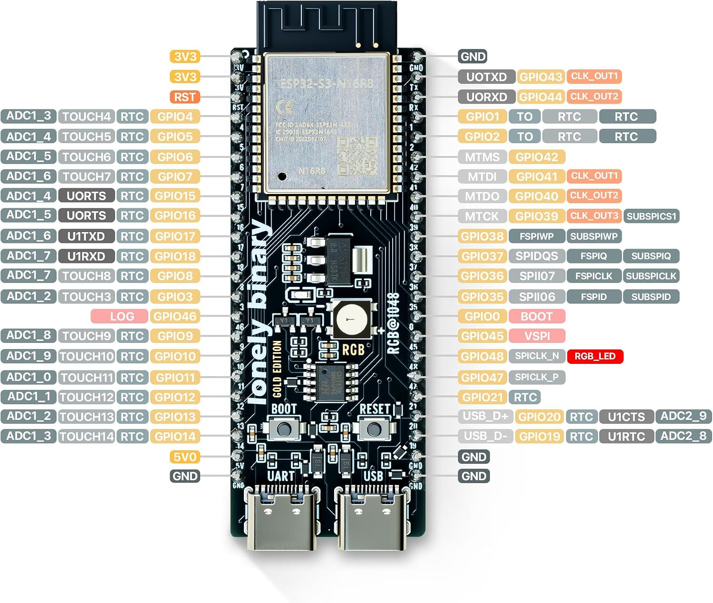

# Window Opener Project

ESP32-S3 firmware controlling a linear window actuator with separate OPEN and CLOSE relay outputs. The default device identity is configured in AppConfig; see [Creating Another Named Instance](#creating-another-named-instance) to configure a unique identity for another opener.

## Status

Firmware and local tests are implemented on the `window-opener` branch. Host controller/output, MQTT service protocol, LED and foundation startup tests pass. The ESP32-S3 UART build passes. Physical wiring, actuator travel/end stops, live Home Assistant and OTA operation remain unverified. Firmware has not been uploaded as part of implementation.

## Window Status LED Colors

After startup, the onboard LED on **GPIO48** shows the window state with a **steady color**:


| Window state | LED color | Meaning |
| --- | --- | --- |
| **Open** | **Blue** | The OPEN run timer finished; the window is assumed open. |
| **Closed** | **Green** | The CLOSE run timer finished; the window is assumed closed. |
| **Unknown** | **Red** | No endpoint is known: after boot, STOP, or OTA interruption. |
| Durring Opening / Closing | Keep the previous endpoint color | Blue if previously Open, green if previously Closed, red if Unknown. |

Open and Closed are assumed endpoints; there is no position feedback. The LED is not a separate HA entity.

## Startup LED Sequence

During startup, the same LED flashes blue to show connection progress. Once both startup stages finish, it switches to the steady window-state color above.

| Startup stage | LED pattern | Duration |
| --- | --- | --- |
| Connecting to Wi-Fi | Slow blue flashes | At least 2 seconds; continues until Wi-Fi connects. |
| Connecting to MQTT | Fast blue flashes | At least 2 more seconds; continues until both connections are ready. |

Network services and movement timing continue during startup. These flashing patterns run only at startup.

## Home Assistant Behavior

MQTT discovery creates a window cover with OPEN, CLOSE and STOP controls. Each direction command starts a 30-second run; repeated commands in the same direction restart it. Reversal first turns both outputs off for 500 ms, then starts the new direction and its full run timer. New commands replace pending movement; STOP cancels both active and pending movement immediately.

At timeout both outputs turn off and firmware reports the requested endpoint. **Open and Closed are assumptions, not measured positions.** The actuator must have working internal end-of-travel limit switches. STOP reports Unknown. Every boot starts inactive and reports Unknown rather than restoring retained position. Discovery translates Unknown into HA's unknown cover state.

Wi-Fi/MQTT loss allows the local timed movement to finish. Reconnection republishes current status. Before OTA starts, firmware stops outputs, cancels pending movement and sets Unknown; it publishes that state if connected. If OTA fails, outputs stay off until a new command. Like the foundation, network connection attempts use synchronous library calls, so the local loop is cooperative rather than a hard real-time cutoff.

| Purpose | Topic | Payload / retention |
| --- | --- | --- |
| Command | `devices/WindowOpener_Left/window/set` | Exact `OPEN`, `CLOSE`, `STOP`; non-retained |
| State | `devices/WindowOpener_Left/window/state` | `Opening`, `Closing`, `Open`, `Closed`, `Unknown`; retained |
| Availability | `devices/WindowOpener_Left/availability` | `online` / `offline`; retained, Last Will offline |
| Discovery | `homeassistant/cover/WindowOpener_Left/window/config` | Retained JSON |
| Rain event | `weather/events` | `{"event":"rain_started"}`; non-retained |

A rain-start event starts the same timed CLOSE operation. A later explicit command preempts it; another rain event restarts CLOSE. There is no continuing-rain lockout. An offline opener can miss this non-retained event. Publishers must enforce non-retained commands/events; the device does not reject retained delivery. Invalid commands, malformed JSON and unrelated weather events leave movement unchanged. Rain messages are limited to 256 bytes. `weather/outdoor_temperature_c` is not consumed.

Home Assistant's rain-start automation will be configured separately later. It should publish `{"event":"rain_started"}` to `weather/events` with `retain: false` on the transition into rain, not continuously while raining.

## Wiring and Configuration

| Signal | GPIO | Behavior |
| --- | ---: | --- |
| OPEN relay input | 10 | Active HIGH |
| CLOSE relay input | 11 | Active HIGH |
| Onboard WS2812 | 48 | Startup and window status |

`include/AppConfig.h` exposes `OpenRelayPin`, `CloseRelayPin`, `WindowRunMs` (30000) and `ReversalPauseMs` (500). Both direction pins are initialized LOW before networking. Output writes clear the inactive direction before asserting the other.

GPIOs are logic outputs only. Use appropriately rated actuator power and relay hardware providing the required direction-control circuit. Verify polarity, GPIO availability and reset/boot behavior before connecting the actuator; firmware cannot control pins while the ESP32 is held in reset. Confirm the actuator's internal limit switches stop travel and that 30 seconds covers the full stroke. Enclosure design and a right-side opener are out of scope.

## Starting Board

The initial target is the Lonely Binary ESP32-S3 Gold Edition N16R8: an ESP32-S3-DEVKITC-1 V1.6 with 16 MB QIO flash, 8 MB OPI PSRAM, two USB-C ports, and one WS2812 RGB LED on GPIO48.



PlatformIO uses the `esp32-s3-devkitc-1` board profile, with N16R8 flash and PSRAM settings in `platformio.ini`.

## Programming and Serial Console

Start with the USB-C port labeled **UART**. This is the default programming and serial-monitor path through the CP2102 bridge:

```powershell
pio run -e esp32-s3-uart -t upload
pio device monitor -e esp32-s3-uart
```

If using the other USB-C port labeled **USB**, select the Native USB environment:

```powershell
pio run -e esp32-s3-usb -t upload
pio device monitor -e esp32-s3-usb
```

If both ports or multiple boards are connected, select the matching serial port in PlatformIO before uploading or opening the monitor.

## Setup and OTA

Copy `include/secrets.example.h` to the ignored `include/secrets.h` and set local Wi-Fi, MQTT and OTA credentials. Never commit secrets. This project retains the foundation broker configuration (plain MQTT on the home LAN); `MqttHost` and `MqttPort` are in AppConfig.

For OTA, configure `ESP32_OTA_PASSWORD` in the current shell to match local `OTA_PASSWORD`, then use `pio run -e esp32-s3-ota -t upload`. OTA is disabled without a password. Initial flashing uses UART as shown above. Serial diagnostics run at 115200 baud.

## Creating Another Named Instance

Give each physical opener a unique device ID, for example `WindowOpener_Right`. This ID is used for the MQTT client, MQTT topics, Home Assistant discovery identifiers, and OTA hostname. The human-readable name shown by Home Assistant is configured separately.

In the ignored `include/secrets.h`, set the values for the new instance:

```cpp
#define APP_DEVICE_ID "WindowOpener_Right"
#define APP_DEVICE_NAME "Right Window Opener"
```

In the current firmware, changing these values in `secrets.h` alone will not take effect: `include/AppConfig.h` forcibly defines `APP_DEVICE_ID`, and `DeviceName` is hard-coded there. To use the per-device values above, replace the forced ID definition with defaults that preserve the existing values when secrets do not provide them:

```cpp
#ifndef APP_DEVICE_ID
#define APP_DEVICE_ID "WindowOpener_Left"
#endif

#ifndef APP_DEVICE_NAME
#define APP_DEVICE_NAME "Left Window Opener"
#endif
```

Then set `AppConfig::DeviceName` from `APP_DEVICE_NAME` instead of a string literal. Keep `AppConfig::DeviceId` using `APP_DEVICE_ID`. With those changes, the new firmware publishes under its own MQTT and Home Assistant identity while the existing left opener keeps its ID and name. Do not commit `secrets.h` or credentials.

For OTA on the renamed device, change `upload_port` in the `[env:esp32-s3-ota]` section of `platformio.ini` to the same ID followed by `.local`, for example:

```ini
upload_port = WindowOpener_Right.local
```

The ID in `secrets.h` and the OTA upload target must match. USB/UART uploads do not use this OTA hostname setting.

## Build and Validation

```powershell
pio run -e esp32-s3-uart
powershell -ExecutionPolicy Bypass -File tools/test_window.ps1
```

The test script requires g++ and the ArduinoJson headers installed by the UART build. MQTT service tests compile the production service with real ArduinoJson and a fake PubSubClient transport; they do not exercise the LAN broker or Home Assistant. All ten existing foundation Python MQTT wire regression tests also pass. The original foundation MQTT wire runner remains available for foundation devices, not this cover.

Before sign-off, verify the startup flashes, inactive boot outputs, directions, relay polarity, reversal pause, end stops, timeout, STOP, rain close, LED colors, HA cover commands/states/availability, and OTA stop/reconnect behavior on the device. Configure HA's rain publisher separately and confirm it sends non-retained events. See [plan.md](plan.md) for accepted behavior and remaining validation.
