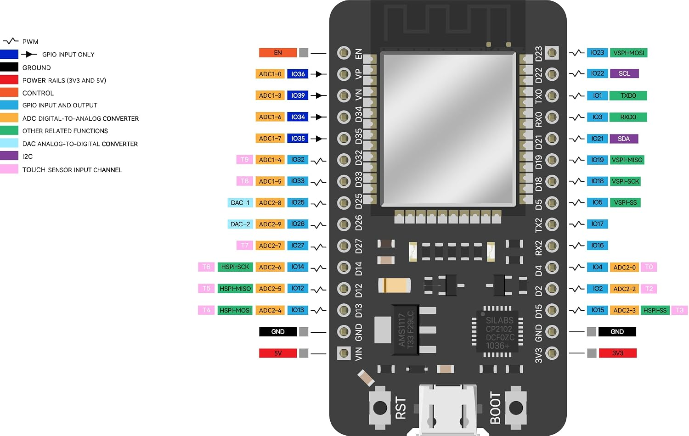

# ESP32 Project Foundation

A reusable PlatformIO/Arduino foundation for ESP32 projects using Wi-Fi, OTA firmware updates, MQTT, and Home Assistant MQTT discovery.

## Starting Board

The initial target is the ELEGOO ESP32 development board with an ESP-WROOM-32 module, CP2102 USB-to-serial bridge, USB-C connector, and 4 MB SPI flash. PlatformIO uses the `esp32dev` board profile.

Pinout reference for the starting board:

## Setup

1. Copy `include/secrets.example.h` to `include/secrets.h`.
2. Set the Wi-Fi password and a unique OTA password in `include/secrets.h`. The SSID is set to `ElCamino` in the example.
3. Check that the board's onboard LED is connected to GPIO 2 and confirm its polarity. Override `APP_LED_PIN` or `APP_LED_ACTIVE_LOW` in `include/secrets.h` if needed. GPIO 2 is a provisional default, not a verified property of every board revision.
4. Build with `pio run -e esp32dev` and initially upload over USB with `pio run -e esp32dev -t upload`.
5. Set the same OTA password in the current PowerShell session as `ESP32_OTA_PASSWORD`, then upload over the network with `pio run -e esp32dev_ota -t upload`. The device must already be running firmware with ArduinoOTA enabled on the same LAN.

The local `include/secrets.h` file is ignored by Git. Do not commit Wi-Fi or OTA passwords.

## MQTT and Home Assistant

The initial broker is `192.168.0.179:1883` over plain MQTT/TCP, with anonymous access. Home Assistant is already connected to this broker; the firmware publishes MQTT switch discovery for that existing integration.

| Purpose | Topic | Payload |
| --- | --- | --- |
| Command | `devices/esp32-foundation-01/led/set` | `ON` or `OFF` |
| Reported state | `devices/esp32-foundation-01/led/state` | `ON` or `OFF` |
| Availability | `devices/esp32-foundation-01/led/availability` | `online` or `offline` |
| Home Assistant discovery | `homeassistant/switch/esp32-foundation-01/led/config` | Retained JSON configuration |

The device publishes reported state and discovery retained, and uses an MQTT Last Will for offline availability. Commands should not be published retained. The broker permits anonymous, unrestricted publish/subscribe on the home LAN, so do not send secrets over MQTT or expose this device to untrusted networks.

## Future Purchases

[ELEGOO ESP32 development board](https://link.amazon/B01nJKKED)